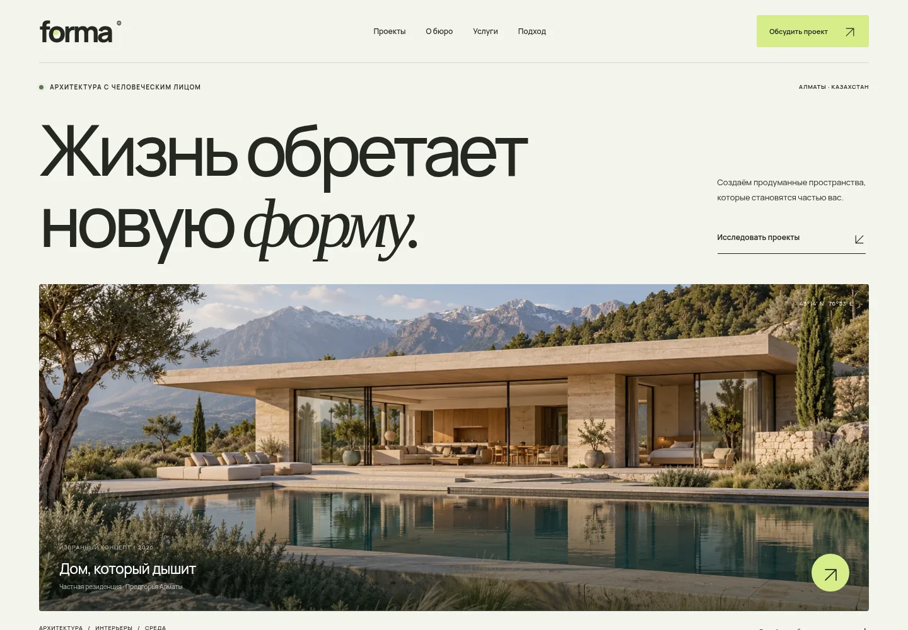

# FORMA — пространство для жизни

[**Открыть сайт ↗**](https://nurmukasan.github.io/Zamanbek-Exam/)



Адаптивный сайт вымышленного архитектурного бюро. HTML, CSS и JavaScript без библиотек, сборки и обязательных внешних запросов. Шрифт Manrope и изображения хранятся локально.

## Что работает

- Анимации появления и наведения с поддержкой `prefers-reduced-motion`.
- Мобильное меню, управление с клавиатуры и закрытие по Escape.
- Фильтр проектов, модальные окна с описанием каждого проекта.
- Раскрывающиеся описания услуг.
- Демо-форма с обязательными полями, проверкой email и скачиванием заявки в `.txt`.

Форма **не отправляет** заявку в компанию: она создаёт файл на устройстве посетителя. Введённые данные не отправляются на сервер и не записываются в localStorage. Для реального приёма заявок нужно отдельно подключить сервер или сервис обработки форм.

## Локальный запуск

Из корня репозитория:

```sh
python3 -m http.server 8000 --bind 0.0.0.0
```

Откройте локальный сервер в браузере. Можно также открыть `index.html` как файл; HTTP-сервер предпочтителен для проверки сайта.

## Публикация на GitHub Pages

Сайт публикуется из ветки `gh-pages`. Адрес:

**https://nurmukasan.github.io/Zamanbek-Exam/**

В **Settings → Pages → Build and deployment** выбран источник **Deploy from a branch → gh-pages → / (root)**. Workflow `.github/workflows/pages.yml` синхронизирует новые изменения из `main` в `gh-pages`, запрашивает сборку и проверяет опубликованный HTML. Поэтому изменения в `main` публикуются автоматически. HTML, стили и скрипты используют относительные пути и корректно работают в подпапке репозитория.

Ветка `gh-pages` содержит только готовые файлы сайта; исходники и workflow находятся в `main`. Статус сборки доступен во вкладке **Actions**, адрес — в **Settings → Pages**. Для повторной публикации текущего `main` откройте **Actions → Publish website to GitHub Pages → Run workflow**.

## Как устроен сайт

- `index.html` — разметка и тексты разделов, форма, диалог проекта.
- `styles.css` — оформление, адаптация, анимации.
- `script.js` — меню, фильтры, диалоги и локальная подготовка заявки.
- `assets/images/` — концептуальные архитектурные иллюстрации.
- `assets/fonts/` — локальный Manrope и лицензия SIL Open Font License.

Компания, адреса проектов и сами проекты — вымышленные концепции. Контактные данные реального бюро не используются.
